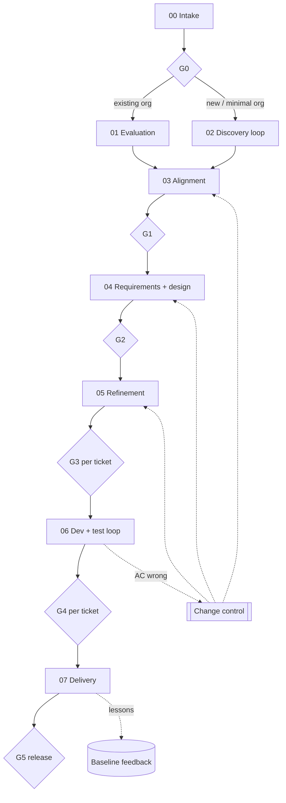

# Project workflow map

**Verdict:** work moves through 8 phase workflows and 6 gates. No build before G2, no sprint entry before G3, no Done before G4, no production before G5. Change control runs from G1 onwards. Every step checks guardrails (`../guardrails/README.md`).

## Which workflow when
| Situation | Workflow |
|---|---|
| New project | 00 → 01 or 02 → 03 → 04 → 05 → 06 → 07 |
| Joining an existing org | 00 → **01 Evaluation** first (read-only) |
| New org or barely customised | 00 → **02 Discovery loop** |
| Someone asks for a change | `processes/change-control.md` |
| Picking up a Ready ticket | 06 Dev + test loop |
| Shipping | 07 Delivery |

## Gates
| Gate | Passes when | Checked by |
|---|---|---|
| G0 | baseline pinned, path, team profile, roles | `tools/status.py` |
| G1 | project guardrails, migration plan, pattern register approved; no gate overrides; waivers complete | `tools/status.py` |
| G2 | design signed off; no open / low-confidence must-decide items | `tools/gate_check.py` (also blocks force-app writes) |
| G3 | ticket Ready per schema; metadata names verified; links resolve | `tools/ticket_lint.py` |
| G4 | all AC pass; agreed tests in source; coverage; analyzer clean; reviewed | `tools/dev_cycle.py dod` + PR review |
| G5 | validated deploy, UAT sign-off, rollback plan, change window | CI + approver |

## Three layers in this package
| Layer | Answers | Where |
|---|---|---|
| Guardrails | what must always hold, how it is measured | `../guardrails/` |
| Best practices | what good looks like and why | `../best-practices/` |
| Workflow | who does what, in which order, checking which guardrail | `./` |
